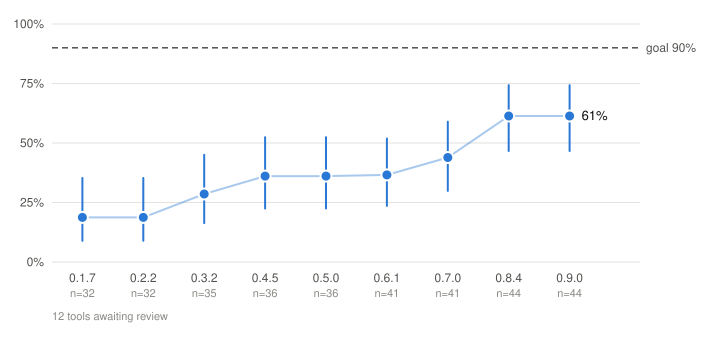

<div align="center">
     


<!-- LOGO: a ~96px mark goes here. Something jaw/mandible-shaped reads well at this
     size. Replace this comment with:  -->

# mandible

*A TUI manual for every command-line tool you have*

[](https://github.com/AS-FOSS/mandible/actions/workflows/ci.yml)
[](https://github.com/AS-FOSS/mandible/actions/workflows/frameworks.yml)
[](https://crates.io/crates/mandible)
[](#license)


[Install](#install) • [How it works](#how-it-works) • [Coverage](#is-it-actually-universal) • [Keys](#keys)

</div>

`man` tells you about one command. `--help` tells you about one invocation. Neither explores a tool you don't already know.

```console
$ mandible docker
```

<p align="center">
     


  <br>
  <em>A tree of every command, subcommand and flag on the left. The selected one's documentation on the right.</em>
</p>


> [!TIP]
> Try running `mandible mandible`

## Install

Linux and macOS, on x86_64 and arm64. Windows is not supported: the containment above
relies on POSIX process groups, and Windows tools use conventions (`/?`, PowerShell's
own help system) this project does not speak.

**Cargo**

```console
# fetch prebuilt binary
cargo binstall mandible
```

```console
# build from source
cargo install mandible
```

**Fedora / EPEL** (COPR repo)

```console
sudo dnf copr enable as-foss/mandible
sudo dnf install mandible
```

**Nix**

```console
nix run github:AS-FOSS/mandible
```

**Homebrew** (macOS or Linux)

```console
brew install as-foss/mandible/mandible
```

**Debian / Ubuntu** (signed apt repo)

```console
sudo curl -fsSL https://as-foss.github.io/mandible-apt/mandible-archive-keyring.gpg \
  -o /usr/share/keyrings/mandible-archive-keyring.gpg
sudo tee /etc/apt/sources.list.d/mandible.sources >/dev/null <<'EOF'
Types: deb
URIs: https://as-foss.github.io/mandible-apt
Suites: stable
Components: main
Architectures: amd64 arm64
Signed-By: /usr/share/keyrings/mandible-archive-keyring.gpg
EOF
sudo apt-get update && sudo apt-get install mandible
```


Standalone binaries, `.deb` and `.rpm` packages, each with a `.sha256`, are attached
to every [release](https://github.com/AS-FOSS/mandible/releases/latest).

## How it works

mandible asks the tool itself. It reads the tool's `--help`, its shell completion
script when one is installed, and its own completion protocol where it has one
(cobra's `__complete`, for example).

There is no per-tool code: no list of known tools, no hand-written definitions that
fall out of date. Most help text is printed by one of a small set of argument-parsing
libraries, so mandible works out which one produced it and reads it with that
library's grammar:

<div align="center">
     <table>
       <tr><td><b>Rust</b></td><td>clap (v2, v3/v4)</td></tr>
       <tr><td><b>Go</b></td><td>cobra, urfave/cli, stdlib flag</td></tr>
       <tr><td><b>Python</b></td><td>argparse, click, docopt</td></tr>
       <tr><td><b>JavaScript</b></td><td>commander, yargs, oclif</td></tr>
       <tr><td><b>Java / .NET</b></td><td>picocli, System.CommandLine</td></tr>
       <tr><td><b>Others</b></td><td>GNU argp/getopt_long, busybox, Symfony Console, OptionParser/Thor, BSD-terse</td></tr>
     </table>
</div>

Help written by hand is read with general rules for the common layouts. When mandible
cannot make sense of a page, `t` still shows it as the tool printed it.

> [!TIP]
> Open straight at a subcommand: `mandible cargo clippy`. Subcommands that live
> as separate `<tool>-<sub>` binaries (`cargo-clippy`, `git-lfs`) show up too,
> marked `unverified`: they were found on `PATH`, not in the parent's own help.

## Is it actually universal?

It opens any tool, but it does not read every tool correctly yet.

<p align="center">
  
</p>

Accuracy is checked by hand. A person draws a random sample of tools mandible was never
tuned for, commits the sample before judging any of them, and compares each tool in
mandible with its own `--help`. In the latest audit, on 0.9.0, **27 of 44 tools were fully
correct (61%)**; the true rate is likely between 47% and 74%. A tool only counts as correct
when every one of its flags and subcommands is read right. Every older release is scored
on the same tools, which gives the line above, and the dashed line is the goal: 90%.
[How the numbers are made](docs/accuracy.md).

CI checks every change against the help pages of a fixed set of real tools, and a
separate sweep runs mandible over every tool on a machine's `PATH` and checks that
the trees make sense, not only that something came out.

So check anything surprising against the tool's own `--help`. To help raise the
number, see [Contributing](#contributing).

<details>
<summary><h2>Keys</h2></summary>

`?` lists every key. The ones you will use most:

| Key | Does |
|---|---|
| `↑` `↓` or `k` `j` | Move |
| `→` `Enter` or `l` | Expand |
| `←` or `h` | Collapse, or go to the parent |
| `Tab` | Switch between the list and the page |
| `/` | Search names; press again to search descriptions too |
| `n` `p` | Next or previous match on the page |
| `s` | Sort the focused pane |
| `w` | Wrap long lines, or scroll them sideways |
| `t` | Show the tool's own `--help` |
| `y` | Copy the selected flag or command |
| `r` | Reload |
| `q` | Quit |

A search matches rows that contain every word you type, in any order: `no verify`
finds `--no-verify`. `Tab` in the search box takes the dim suggestion.

</details>

<details>
<summary><h2>Configuration</h2></summary>

Press `?`, then `Tab`, to change settings inside mandible. A change shows at once and
is saved to `~/.config/mandible/config.toml` (on macOS,
`~/Library/Application Support/mandible/config.toml`). You can also edit the file by
hand. A line mandible cannot read is skipped, and the footer says which one.

Every setting, with its default:

```toml
[ui]
raw_view = false             # start in the tool's own --help view
horizontal_scroll = false    # scroll long lines sideways instead of wrapping them
description_preview = true   # false shows long descriptions in full, in place
ascii = false                # ASCII glyphs instead of Unicode

[sort]                       # where `s` starts
flags = "tool"               # "tool", "az-sections" or "az"
commands = "tool"            # "tool" or "az"

[colors]
theme = "default"
```

Themes: `default`, `light`, `high-contrast`, `gruvbox-style`, `nord-style`,
`dracula-style`, `catppuccin-style`, `none` (no colour) and `custom`. With `custom`,
set any of these to a colour name (`black` to `bright-white`) or a number from 16 to
255. One you leave out keeps the `default` theme's colour.

```toml
[colors]
theme = "custom"
accent = "bright-cyan"   # flag names, focused border
warning = 220            # notices, low confidence
muted = "bright-black"   # secondary text
section = 246            # section headings
group = 240              # group headings
selection = 237          # selection bar
selection_text = 252     # text on the selection bar
```

Environment variables win over the file:

| Variable | Effect |
|---|---|
| `NO_COLOR` | No colour, like `theme = "none"` |
| `MANDIBLE_ASCII=1` | ASCII glyphs, like `ascii = true` |
| `MANDIBLE_CONFIG_DIR` | Read the config from this directory instead |
| `MANDIBLE_LOG` | Debug log filter, written to stderr, e.g. `MANDIBLE_LOG=debug` |

</details>

<details>
<summary><h2>Shell integration</h2></summary>

**Completions.** The packages install them. For a hand-built binary,
`mandible --completions <shell>` prints the script for bash, zsh, fish, elvish or
PowerShell. For zsh:

```console
$ mkdir -p ~/.zfunc && mandible --completions zsh > ~/.zfunc/_mandible
```

Then add `fpath=(~/.zfunc $fpath)` to `~/.zshrc`, above `compinit`.

**Onto the prompt.** Add this to `~/.bashrc` or `~/.zshrc`:

```sh
eval "$(mandible --shell-init bash)"   # or zsh
```

Type a tool name, press `Ctrl-X m`, browse, and press `Enter`. The command you
selected, say `git commit --amend`, replaces your command line, ready to edit. `q`
leaves the line as it was.

</details>

<details>
<summary><h2>Troubleshooting</h2></summary>

**Correct a tool for yourself.** Put corrections in
`~/.config/mandible/overrides/<tool>.toml`.

**What did mandible understand?** `mandible --doctor <tool>` shows the framework it
detected, the sources it used and how much of the tool it understood. A probe stops
after 30 seconds; add `--no-timeout` to wait longer.

**Running as root.** mandible refuses, because under root a `--help` probe that
reaches a daemon is an action, not a question. `--allow-root` proceeds anyway;
mandible never gains privileges itself.

</details>

## Contributing

**Report a tool that looks wrong.** Run `mandible --report <tool>` and paste the output
into [an issue](../../issues/new?template=parsing-issue.yml). The report records your
tool's version and its exact help text, which nobody can get back once you upgrade, so
it is a complete contribution on its own.

**Audit mandible against your own tools.** Every accuracy figure here comes from one
Ubuntu machine on ARM, so the tools on your `PATH` are probably ones this project has
never seen.

```console
$ git clone https://github.com/AS-FOSS/mandible && cd mandible
$ cargo xtask audit contribute
```

It draws twenty tools from your `PATH` and opens each one in mandible. Press `t` to
compare with the real help text, then `c`, `i`, `w` or `s` for correct, incomplete,
wrong or skip. It saves after every verdict, and at the end prints the commands to
open the pull request. Merged audits are credited in the release notes.

> [!NOTE]
> Judge by eye, in the interface. No AI, no scripts, no verdicts from a text dump:
> spotting what is missing or wrong is the whole point of an audit.

**Change the code.** Start with [`CONTRIBUTING.md`](./CONTRIBUTING.md).
[`AGENTS.md`](./AGENTS.md) has the rules every change must keep.

## License

MIT or Apache-2.0, at your option: [LICENSE-MIT](./LICENSE-MIT),
[LICENSE-APACHE](./LICENSE-APACHE).

## Documentation

| | |
|---|---|
| [`docs/design.md`](./docs/design.md) | Design authority: the source model, the safety policy, and the measurement behind every non-obvious decision |
| [`AGENTS.md`](./AGENTS.md) | The invariants table. Every entry names the failure it prevents |
